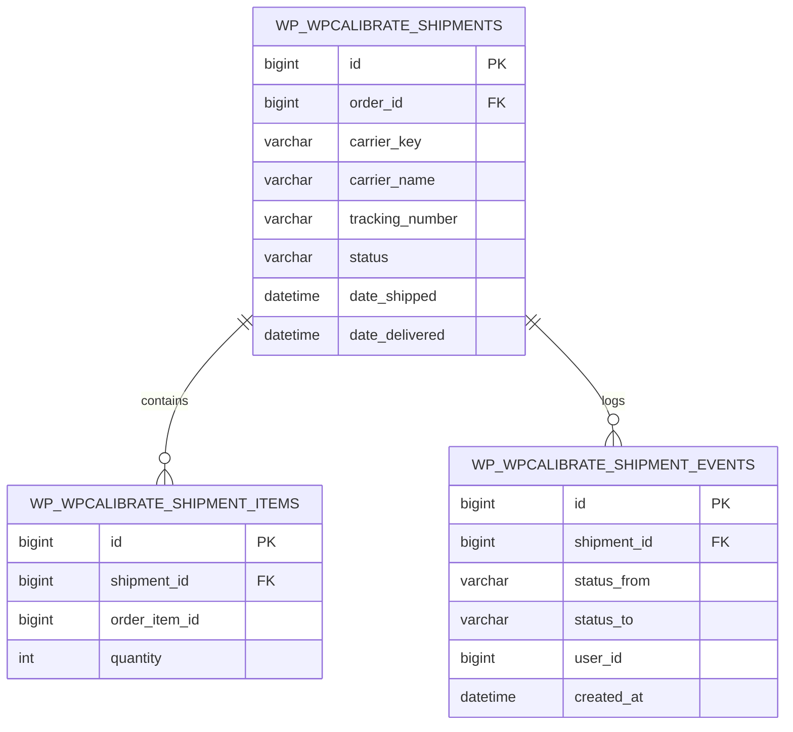

# WPCalibrate Shipment Tracker

[](https://github.com/zeeshanraza-official/wpcalibrate-shipment-tracker/releases/latest)
[](https://wordpress.org/)
[](https://woocommerce.com/)
[](https://php.net/)
[](https://woocommerce.com/document/high-performance-order-storage/)
[](https://www.gnu.org/licenses/gpl-2.0.html)

> **Enterprise-grade WooCommerce physical shipment tracking, multi-package allocation math, carrier link integration, and self-service customer delivery timelines.**

Developed and maintained by [WPCalibrate](https://wpcalibrate.com).

---

## 📖 About

In standard WooCommerce environments, orders operate strictly on order-level statuses (*Processing*, *Completed*, *On Hold*). When store fulfillment teams dispatch packages across multiple warehouses, split deliveries, or handle partial backorders, shoppers are left without parcel-level visibility, driving delivery inquiry tickets (WISMO: *"Where is my order?"*) that typically consume over 70% of customer support bandwidth.

**WPCalibrate Shipment Tracker** solves this challenge by introducing enterprise logistics architecture into WooCommerce:

- **True Partial Order Fulfillment**: Split line items across separate physical packages with mathematical safeguards preventing over-fulfillment.
- **Relational High-Performance Tables**: Avoids database bloat by storing shipments in dedicated, indexed tables rather than overburdened `wp_postmeta` tables.
- **Native WooCommerce HPOS Compatibility**: Built from the ground up for WooCommerce High-Performance Order Storage (Custom Order Tables) and legacy post storage alike.
- **Direct GitHub Automated Dashboard Updates**: Seamlessly receive update notifications and perform 1-click upgrades directly from your WordPress dashboard as new releases are published to GitHub.

---

## ✨ Features

### 📦 Multi-Package Dispatch & Item Allocation Math
- Assign multiple tracking numbers, carriers, and dispatch dates to a single WooCommerce order.
- Exact unit quantity allocation per parcel: `Available Units = Ordered - Refunded - Assigned`.
- Automatic validation preventing fulfillment of refunded products or exceeding purchased line item totals.

### 🚚 Global Carrier Network & Unlimited Custom Couriers
- **7 Preconfigured Couriers**: Instant deep tracking links for UPS, FedEx, USPS, DHL Express, Royal Mail, Canada Post, and Australia Post.
- **Custom Courier URL Builder**: Add regional or freight carriers using the dynamic `{tracking_number}` URL token placeholder.
- Brand badges, status toggles, and 1-click template testing.

### ⏱️ Self-Service Customer Delivery Timelines
- Visual progress bar and milestone tracking on the **My Account > Orders** dashboard.
- Chronological status history: *Preparing*, *Shipped*, *In Transit*, *Out for Delivery*, *Delivered*, *Delivery Exception*, and *Returned*.
- Clear parcel breakdown detailing exact products and quantities enclosed in each parcel.

### 🔒 Brute-Force Defended Public Guest Tracking Portal
- Dedicated shortcode `[wpcalibrate_shipment_tracking]` for non-logged-in guest shoppers.
- Constant-time verification (`hash_equals`) matching Order ID and Billing Email address.
- Cryptographic SHA-256 IP rate limiter protecting customer privacy against automated order enumeration attacks.

### ✉️ Transactional Email Integration & Automation
- Dedicated `WPC_Shipment_Updated_Email` notifying shoppers upon parcel dispatch with direct carrier tracking buttons.
- Optional automatic order status transition to *Completed* once all consignments are marked *Delivered*.

### 🛍️ Built-in Testing Catalog Seeder
- One-click testing seeder under **Settings > Advanced** generating 5 realistic WooCommerce products with SKUs, prices, categories, and inventory.

### 🔄 Automatic WordPress Dashboard Updates
- Integrated GitHub Updater automatically checks GitHub releases via API.
- Store administrators can update the plugin with 1-click directly from **Dashboard > Updates** or the **Plugins** screen.

---

## 📋 System Requirements

| Requirement | Minimum Supported | Tested & Recommended |
|---|---|---|
| **PHP** | 8.2 (Strict typing enforced) | 8.2, 8.3, 8.4 |
| **WordPress** | 6.4 | 6.7.x |
| **WooCommerce** | 8.5 | 10.x & 11.2.x |
| **Storage Engine** | MySQL 5.7+ / MariaDB 10.3+ | InnoDB / HPOS Custom Tables |

---

## 🚀 Installation & Updates

### Option 1: WordPress Dashboard (1-Click ZIP Upload)
1. Download the latest release: [`wpcalibrate-shipment-tracker-1.0.4.zip`](https://github.com/zeeshanraza-official/wpcalibrate-shipment-tracker/releases/latest).
2. In your WordPress admin, go to **Plugins > Add New Plugin > Upload Plugin**.
3. Select the downloaded ZIP file and click **Install Now**.
4. Click **Activate Plugin**.

### Option 2: Updating from WordPress Dashboard
Once installed, future updates published on GitHub are automatically detected by WordPress. When an update is released:
1. Navigate to **Dashboard > Updates** or **Plugins** in your WordPress admin.
2. Click **Update Now** alongside WPCalibrate Shipment Tracker to perform an instant, in-place upgrade.

### Option 3: Manual FTP / SFTP Installation
1. Extract `wpcalibrate-shipment-tracker-1.0.4.zip` to your computer.
2. Upload the `wpcalibrate-shipment-tracker` directory to `/wp-content/plugins/` on your server.
3. Activate the plugin in **Plugins > Installed Plugins**.

### Option 4: Git Clone
```bash
cd wp-content/plugins/
git clone https://github.com/zeeshanraza-official/wpcalibrate-shipment-tracker.git wpcalibrate-shipment-tracker
```

---

## 📚 Documentation & Operator Guide

### 1. Fulfilling an Order with Tracking Number
1. Navigate to **WooCommerce > Orders** in your admin sidebar.
2. Click on any *Processing* order to open the order details screen.
3. Locate the **Shipments & Tracking** card (fully compatible with HPOS and classic views).
4. Click **Add Shipment** to open the accessible modal.
5. Select your shipping carrier, enter the tracking code, and select status (*Shipped*).
6. Adjust item quantities to specify what is packed inside this box.
7. Click **Save Shipment**. The customer receives an email update automatically.

### 2. Setting Up the Public Guest Tracking Page
1. Go to **Pages > Add New** in WordPress.
2. Title the page (e.g. *Track Your Order*).
3. Insert the shortcode block:
   ```text
   [wpcalibrate_shipment_tracking]
   ```
4. Publish the page.
5. Navigate to **WPCalibrate > Shipment Tracker > General** tab, choose your new page under **Public Tracking Page**, and click **Save General Settings**.

### 3. Adding a Custom Courier
1. Navigate to **WPCalibrate > Shipment Tracker > Carriers Registry** tab.
2. In the **Add Custom Carrier** section, enter the courier name and URL template:
   ```text
   https://track.mycourier.com/status?code={tracking_number}
   ```
3. Check **Enable carrier immediately** and click **Add Custom Carrier**.

---

## 🧩 Developer Reference: Action & Filter Hooks

### Action Hooks

| Action Hook | Parameters | Description |
|---|---|---|
| `wpcalibrate_shipment_tracker_shipment_created` | `int $shipment_id, int $order_id, array $data` | Fires immediately after a new shipment record is created. |
| `wpcalibrate_shipment_tracker_status_changed` | `int $shipment_id, string $new_status, string $old_status, int $order_id` | Fires when a consignment transitions to a new milestone status. |
| `wpcalibrate_shipment_tracker_shipment_deleted` | `int $shipment_id, int $order_id` | Fires when a shipment is deleted and items are de-allocated. |

### Filter Hooks

| Filter Hook | Parameters | Description |
|---|---|---|
| `wpcalibrate_shipment_tracker_carrier_registry` | `array $carriers` | Filter the full list of registered carriers and URL templates. |
| `wpcalibrate_shipment_tracker_guest_lookup_verification` | `bool $verified, int $order_id, string $billing_email` | Filter order lookup verification result for custom authorization logic. |
| `wpcalibrate_shipment_tracker_rate_limit_max_attempts` | `int $max_attempts (default: 5)` | Filter maximum failed lookups allowed per IP before lockout. |
| `wpcalibrate_shipment_tracker_rate_limit_lockout_seconds` | `int $lockout_seconds (default: 900)` | Filter lockout duration in seconds (default: 15 minutes). |

---

## 🗄️ Database Architecture

To maintain optimal WooCommerce store performance, WPCalibrate uses three custom relational tables indexed for rapid lookups:



---

## 📝 Changelog

### [1.0.4] - 2026-10-15
- **Fixed**: Resolved critical error on Suite Overview page by adding `get_enabled_carriers()` method alias in `CarrierRegistry`.
- **Hardened**: Wrapped database queries and carrier registry retrieval in defensive `try...catch (\Throwable $e)` blocks with safe fallbacks.
- **Added**: Built-in GitHub Dashboard automated update checker (`GitHubUpdater`) supporting 1-click dashboard updates from GitHub releases.
- **Added**: Comprehensive test assertions expanding automated suite to 38 passed tests.

### [1.0.3] - 2026-10-15
- **Redesigned**: Enterprise WPCalibrate Suite Overview hub (`admin.php?page=wpcalibrate`) with live database consignment metrics, operational health cards, and modern SaaS styling.
- **Enhanced**: Restored `settings_errors` transient handling so success/error banners display reliably on all settings tabs.
- **Enhanced**: Dynamic `filemtime()` asset versioning to eliminate stale browser cache on plugin upgrades.
- **Enhanced**: Added Suite Overview navigation link in Shipment Tracker settings header.

### [1.0.2] - 2026-10-15
- **Fixed**: Eliminated duplicate plugin folders on remote WordPress servers. Enforced single canonical installation path at `wpcalibrate-shipment-tracker`.
- **Enhanced**: Complete card-based redesign across all 8 settings tabs (Overview, General, Tracking, Carriers, Emails, Advanced, License, Support).
- **Added**: Animated custom toggle switches and segmented Dashicons navigation bar.

### [1.0.1] - 2026-10-15
- **Added**: Comprehensive Overview tab with logistics pipeline diagram and operator guides.
- **Added**: Built-in 5 demo products seeder (`DemoDataSeeder`) under Advanced tab.
- **Fixed**: Admin menu branding icon sizing and high-resolution dark branding dashboard header.

### [1.0.0] - 2026-10-15
- Initial production release.
- HPOS compatibility and custom relational database architecture.
- Partial fulfillment allocation engine.
- 7+ built-in carriers, guest tracking shortcode, and WooCommerce transactional email integration.

---

## 🔒 Security & Privacy Architecture

- **Strict Access Control**: Nonce verification and capability checks (`manage_woocommerce` / `edit_shop_orders`) on all AJAX and administrative endpoints.
- **Anti-Enumeration Protection**: Failed guest lookups return uniform, generic responses to prevent store order number discovery.
- **Constant-Time Comparison**: Cryptographic `hash_equals()` validation for billing emails.
- **Privacy First**: IP addresses are SHA-256 hashed with site-unique salt for rate limiting and never stored in plain text.

---

## 📄 License & Commercial Support

- **Author**: [WPCalibrate](https://wpcalibrate.com)
- **Marketplace**: [https://marketplace.wpcalibrate.com/](https://marketplace.wpcalibrate.com/)
- **Direct Support**: support@wpcalibrate.com
- **WhatsApp Direct Line**: [+44 7474 795976](https://wa.me/447474795976)
- **License**: [GNU General Public License v2.0 or later (GPL-2.0-or-later)](https://www.gnu.org/licenses/gpl-2.0.html)
